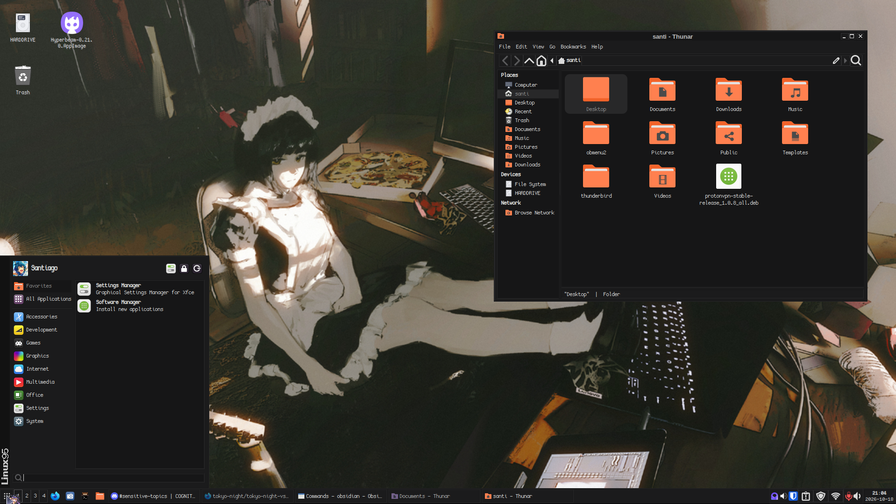
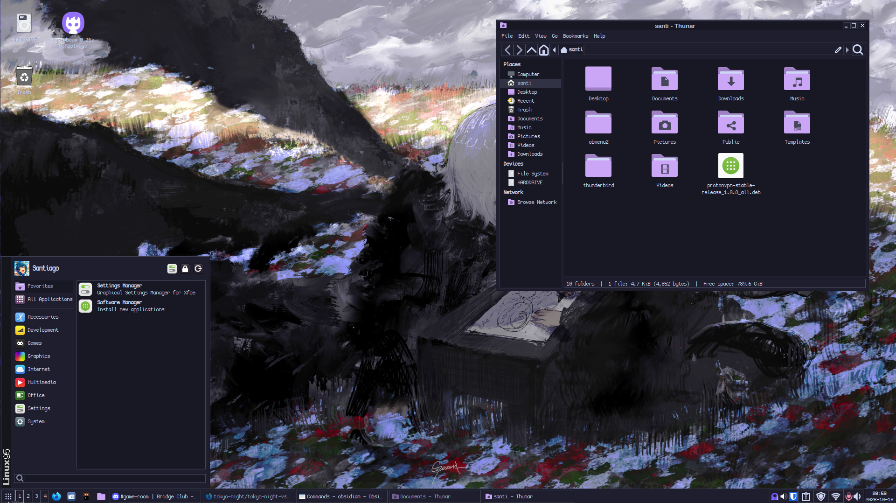
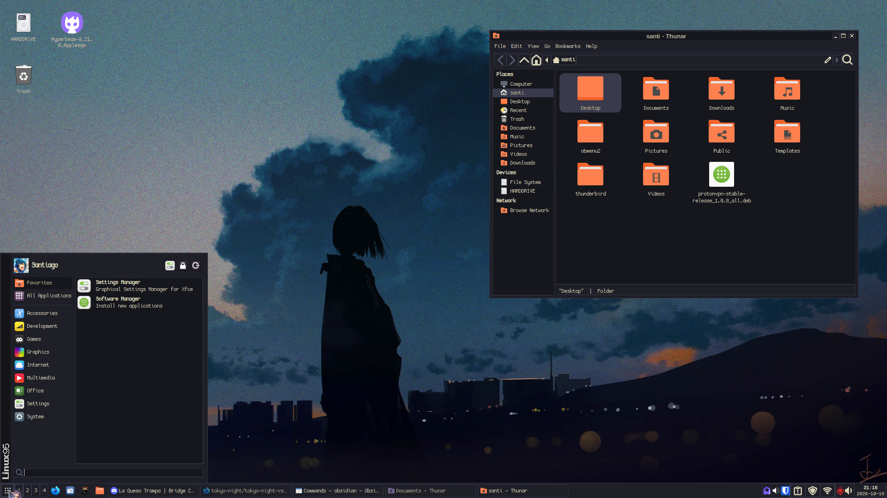
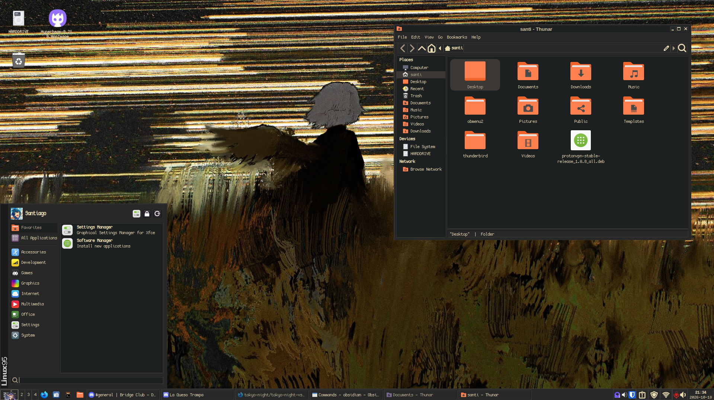

# Miami26
Some windows9x styled gtk themes for linux. Works on MATE and Xfce!. For the most part the code and assets is mainly from Nashville96, but I adjusted the gtk 3 css file to change how colors are defined and shamelessly took the gtk 4 code from Redmond97-SE and added it in the theme.

To be completely honest, I am clueless about gtk css so any updates will be focused on color variations or minor fixes. Apologies!

Feel free to make your own forks or requests!

## Versions Available
- "Basic" - basic black theme, using some colors from [Open color](https://github.com/yeun/open-color)
- [Catppuccin (Mocha)](https://github.com/catppuccin/catppuccin)
- [Kanagawa](https://github.com/rebelot/kanagawa.nvim)
- [Gruvbox](https://github.com/morhetz/gruvbox)
Solarized version wont be updated as of OCT 2026
Toyko Night version soon!

## Screenshots
new screenshots soon!

## This theme would not be possible without the following:
- [donfaustinocortizone](https://github.com/donfaustinocortizone) - [Nashville96](https://github.com/donfaustinocortizone/Nashville96)
- [grassmunk](https://github.com/grassmunk) - [Chicago95](https://github.com/grassmunk/Chicago95).
- [matthewmx86](https://github.com/matthewmx86) - [Redmond97](https://github.com/matthewmx86/Redmond97).
- [Sliver_X](https://codeberg.org/Sliver_X) - [Redmond97SE](https://codeberg.org/Sliver_X/Redmond97-SE)

### License 
This repository contains multiple components with different upstream licenses.  
See `LICENSE.md` and `NOTICE.md` for details.
